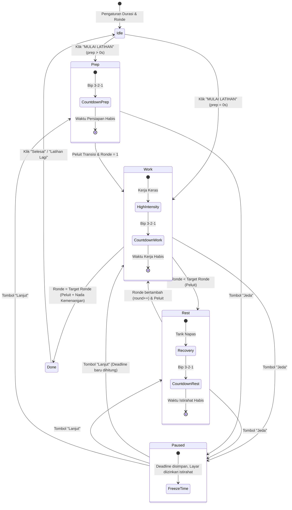

# DOKUMENTASI PROYEK UTS MOBILE PROGRAMMING
# HIIT QUEST — Timer Interval Latihan & Gamifikasi Berbasis Mobile

> **Mata Kuliah:** Mobile Programming (P1 & P2)  
> **Agenda:** Presentasi & Bedah Source Code Proyek Mid Semester  
> **Platform Target:** Hybrid Mobile App (Apache Cordova / Android WebView) & Mobile Web (PWA-Ready)  
> **Teknologi Utama:** Vanilla HTML5, CSS3 Mobile-First, Modern JavaScript (ES6+), Web Audio API, Screen Wake Lock API, Apache Cordova Plugin, Firebase Authentication & Cloud Firestore.

---

## DAFTAR ISI
1. [Deskripsi & Latar Belakang Proyek](#1-deskripsi--latar-belakang-proyek)
2. [Fitur Utama & Keunggulan Mobile](#2-fitur-utama--keunggulan-mobile)
3. [Alur Program & Siklus Hidup (Lifecycle)](#3-alur-program--siklus-hidup-lifecycle)
4. [Struktur Direktori & Arsitektur Kode](#4-struktur-direktori--arsitektur-kode)
5. [Bedah Source Code Mendalam](#5-bedah-source-code-mendalam)
   - [5.1 Alur Logika Timer (State Machine)](#51-alur-logika-timer-state-machine)
   - [5.2 Presisi Waktu & Eliminasi Drift](#52-presisi-waktu--eliminasi-drift)
   - [5.3 Web Audio API (Sintesis Suara Tanpa File Eksternal)](#53-web-audio-api-sintesis-suara-tanpa-file-eksternal)
   - [5.4 Screen Wake Lock API & Cordova Native Plugin](#54-screen-wake-lock-api--cordova-native-plugin)
   - [5.5 Mobile Touch & Pointer Events (Stepper Long-Press)](#55-mobile-touch--pointer-events-stepper-long-press)
   - [5.6 Gamification Engine (XP, Streak, Level, & Lencana)](#56-gamification-engine-xp-streak-level--lencana)
   - [5.7 Sinkronisasi Cloud & Offline Resilience](#57-sinkronisasi-cloud--offline-resilience)
6. [Library & Web/Native API yang Digunakan](#6-library--webnative-api-yang-digunakan)
7. [Panduan Menjalankan Proyek](#7-panduan-menjalankan-proyek)
   - [Opsi A: Demo Cepat via Browser (Tampilan Mobile)](#opsi-a-demo-cepat-via-browser-tampilan-mobile)
   - [Opsi B: Build APK Android via Apache Cordova](#opsi-b-build-apk-android-via-apache-cordova)
8. [Panduan Presentasi & Bedah Kode di Depan Dosen](#8-panduan-presentasi--bedah-kode-di-depan-dosen)
9. [Prediksi Pertanyaan Penguji & Kunci Jawabannya](#9-prediksi-pertanyaan-penguji--kunci-jawabannya)

---

## 1. Deskripsi & Latar Belakang Proyek

**HIIT QUEST** adalah aplikasi mobile untuk memandu latihan interval intensitas tinggi (High-Intensity Interval Training / Tabata). Permasalahan utama dalam latihan interval mandiri adalah hilangnya fokus atlet/pengguna karena harus terus-menerus mengecek jam, layar HP yang sering mati sendiri saat latihan, serta kurangnya motivasi konsistensi berolahraga.

Aplikasi ini memecahkan masalah tersebut dengan menyediakan:
- **Audio Cues Real-time**: Pengguna tahu kapan harus kerja dan istirahat hanya lewat suara tanpa harus melihat layar.
- **Keep-Awake Management**: Mencegah ponsel mengunci layar saat latihan aktif.
- **Gamifikasi Pembentuk Kebiasaan**: Mengubah latihan harian menjadi petualangan berlevel dengan XP, streak harian, dan lencana penghargaan.

---

## 2. Fitur Utama & Keunggulan Mobile

- **Mobile-First Responsive Layout**: Didesain dengan rasio layar smartphone, navigasi bottom bar yang ergonomis untuk jempol tangan (*thumb zone*), serta dialog modal bergaya *bottom sheet*.
- **State Machine Timer yang Ketat**: Urutan fase terstruktur: **Persiapan $\rightarrow$ Kerja $\rightarrow$ Istirahat $\rightarrow$ Kerja $\dots \rightarrow$ Selesai**.
- **Indikator Visual & Audio Lengkap**: Dial radial SVG interaktif dengan sweep animasi, chip status fase, dan hitung mundur 3-2-1.
- **Dukungan Sentuh Responsif (Pointer Events)**: Tombol stepper (+/-) mendukung ketukan tunggal maupun tahan (long-press) dengan akselerasi penambahan angka otomatis.
- **Sistem Suara Mandiri**: Menggunakan Web Audio API tanpa perlu aset MP3 yang membebani memori HP.
- **Dukungan Hibrida**: Berjalan sempurna di browser mobile (PWA) maupun sebagai aplikasi Android native (APK) via Apache Cordova.
- **Mode Uji Bawaan (Testing Mode)**: Opsi pengujian cepat untuk mengabaikan batas minimal durasi latihan demi kemudahan demonstrasi pengujian.

---

## 3. Alur Program & Siklus Hidup (Lifecycle)

### Diagram Alur Fase Timer (State Machine)



### Siklus Hidup Aplikasi Mobile (Mobile Lifecycle)

1. **`DOMContentLoaded`**: Inisialisasi data lokal, pembacaan preferensi audio dari `localStorage`, render ringkasan XP & streak.
2. **`deviceready` (Cordova)**: Menandai plugin native Cordova telah aktif (`cordovaReady = true`), mengaktifkan plugin Insomnia jika latihan sedang berjalan.
3. **`visibilitychange` / `pageshow` / `pagehide`**:
   - Jika pengguna meminimize aplikasi atau berpindah tab: Screen Wake Lock dilepas secara aman untuk menghemat baterai.
   - Jika aplikasi dibuka kembali: Screen Wake Lock diminta kembali dan timer menyinkronkan sisa waktu terhadap `session.deadline` absolut.

---

## 4. Struktur Direktori & Arsitektur Kode

```text
Timer HIT mobile/
├── index.html            # Struktur semantik antarmuka, dialog modal, SVG icon & mascot
├── style.css             # Desain mobile-first, tema fase, token CSS, dan animasi responsif
├── script.js             # Core Engine: Timer state machine, Web Audio API, Wake Lock, Cloud Sync
├── app.js                # Gamification Controller: Perhitungan XP, Streak, Level, Badges
├── firebase-config.js    # Konfigurasi koneksi Firebase Web SDK
├── firestore.rules       # Aturan keamanan database Firestore per pengguna anonim
├── .gitignore            # Filter file build, log, dan konfigurasi lokal IDE
└── README.md             # Dokumentasi teknis & panduan presentasi UTS
```

### Pemisahan Tanggung Jawab (*Separation of Concerns*)

| File | Tanggung Jawab Utama |
|---|---|
| `index.html` | Struktur semantik HTML5, aksesibilitas screen reader (`aria-*`, `role`), container layar pengaturan, layar latihan, layar selesai, serta halaman perjalanan/profil. |
| `style.css` | Mengatur styling bertema gelap (*Dark Mode*), variabel dinamis warna fase (`--phase-bg`, `--phase-ring`), layout CSS Flexbox/Grid, animasi dial melingkar SVG, dan media queries responsif. |
| `script.js` | Mesin utama timer (*Core Timer Engine*): validasi formulir, pelacakan deadline waktu nyata, penjadwalan sintesis audio Web Audio API, integrasi Screen Wake Lock & plugin Insomnia Cordova, serta penyimpanan histori ke Firebase Firestore. |
| `app.js` | Mesin gamifikasi (*Gamification Engine*): kalkulasi akumulasi XP, penentuan level petualang, validasi streak harian berdasarkan zona waktu lokal, pembukaan lencana pencapaian (*badges*), dan observasi perubahan status UI. |
| `firebase-config.js` | Parameter inisialisasi Firebase Web App yang dipisah agar mudah dikonfigurasi tanpa menyentuh logika inti aplikasi. |

---

## 5. Bedah Source Code Mendalam

Bagian ini disiapkan khusus untuk mempermudah penjelasan teknis saat sesi **Bedah Source Code**.

### 5.1 Alur Logika Timer (State Machine)
**Lokasi Kode:** `script.js` (Fungsi `advancePhase`, `enterPhase`, `startSession`)

```javascript
// script.js baris 908 - 922
function advancePhase(previousDeadline, playPhaseSound) {
  if (session.phase === "prep") {
    session.round = 1;
    enterPhase("work", previousDeadline, playPhaseSound);      // PERSIAPAN -> KERJA Ronde 1
  } else if (session.phase === "work") {
    if (session.round >= session.settings.rounds) {
      finishSession(playPhaseSound);                          // Ronde terakhir KERJA -> SELESAI
    } else {
      enterPhase("rest", previousDeadline, playPhaseSound);    // KERJA -> ISTIRAHAT
    }
  } else if (session.phase === "rest") {
    session.round += 1;
    enterPhase("work", previousDeadline, playPhaseSound);      // ISTIRAHAT -> KERJA Ronde Berikutnya
  }
}
```
**Penjelasan untuk Dosen:**
- Urutan fase diatur menggunakan pola *Finite State Machine (FSM)*.
- Sesi dimulai di fase `prep` (persiapan). Begitu persiapan habis, sistem otomatis beralih ke `work` ronde 1.
- Setiap kali fase kerja selesai, sistem memeriksa apakah ronde saat ini sudah mencapai target ronde:
  - Jika **belum**: Masuk ke fase `rest` (istirahat).
  - Jika **sudah**: Langsung memanggil `finishSession()` tanpa menambahkan waktu istirahat di akhir latihan, sesuai prinsip latihan interval Tabata/HIIT.

---

### 5.2 Presisi Waktu & Eliminasi Drift
**Lokasi Kode:** `script.js` (Fungsi `startSession`, `tick`)

```javascript
// script.js baris 935 - 950
function tick() {
  if (!isSessionRunning()) return;

  const now = performance.now();
  // Menggunakan deadline absolut: mencegah akumulasi keterlambatan interval
  while (isSessionRunning() && now >= session.deadline) {
    const previousDeadline = session.deadline;
    const canPlayPhaseSound = document.visibilityState === "visible" && now - previousDeadline <= 1000;
    advancePhase(previousDeadline, canPlayPhaseSound);
  }

  if (isSessionRunning()) {
    renderTimer(now);
    playCountdownForCurrentPhase(now);
  }
}
```
**Penjelasan untuk Dosen:**
- Alih-alih mengandalkan `setInterval(..., 1000)` yang rentan terhadap *timer drift* (waktu melar/molor saat thread JavaScript sibuk atau saat aplikasi berjalan di background HP), aplikasi ini menggunakan **Absolute Deadline**:
  $$\text{deadline} = \text{performance.now()} + (\text{durasiDetik} \times 1000)$$
- Fungsi `tick()` dijalankan dengan interval cepat (100ms) untuk memeriksa waktu terhadap deadline absolut. Jika terjadi lag (misal layar HP baru saja dinyalakan kembali), loop `while` akan langsung memproses seluruh fase yang terlewat secara akurat tanpa kehilangan waktu latihan.

---

### 5.3 Web Audio API (Sintesis Suara Tanpa File Eksternal)
**Lokasi Kode:** `script.js` (Fungsi `initAudio`, `scheduleTone`, `playNotes`, `playCountdownBeep`, `playPhaseTransitionWhistle`)

```javascript
// script.js baris 523 - 548
function scheduleTone(context, note, generation) {
  if (generation !== audioGeneration || context.state !== "running") return;

  const oscillator = context.createOscillator();
  const gain = context.createGain();
  const startAt = context.currentTime + (note.delay || 0);
  const duration = note.duration;

  oscillator.type = note.type || "sine";
  oscillator.frequency.setValueAtTime(note.frequency, startAt);
  // Modulasi frekuensi untuk menghasilkan karakter suara peluit
  if (note.peakFrequency) {
    oscillator.frequency.exponentialRampToValueAtTime(note.peakFrequency, startAt + duration * 0.32);
    oscillator.frequency.exponentialRampToValueAtTime(note.endFrequency || note.frequency, endAt);
  }

  // Envelope ADSR halus untuk mencegah suara 'pop' / 'click'
  gain.gain.setValueAtTime(0.0001, startAt);
  gain.gain.exponentialRampToValueAtTime(note.volume, startAt + attack);
  gain.gain.exponentialRampToValueAtTime(0.0001, endAt);

  oscillator.connect(gain);
  gain.connect(context.destination);
  oscillator.start(startAt);
  oscillator.stop(endAt + 0.01);
}
```
**Penjelasan untuk Dosen:**
- Tidak ada file audio biner (`.mp3` / `.wav`) yang dimuat dari server/lokal. Hal ini menghemat ukuran aplikasi mobile secara signifikan.
- Semua suara disintesis secara matematis menggunakan `AudioContext`:
  - **Countdown Beep (3-2-1)**: Gelombang sinus berfrekuensi 620 Hz – 800 Hz.
  - **Peluit Transisi Fase**: Dua nada osilator simultan dengan modulasi eksponensial frekuensi tinggi (1050 Hz $\rightarrow$ 1580 Hz) menyerupai tiupan peluit wasit.
  - **Nada Selesai (Victory Chords)**: Rangkaian melodi nada E5, G5, dan B5 yang harmonis.

---

### 5.4 Screen Wake Lock API & Cordova Native Plugin
**Lokasi Kode:** `script.js` (Fungsi `requestWakeLock`, `releaseWakeLock`)

```javascript
// script.js baris 631 - 656
async function requestWakeLock() {
  if (!isSessionRunning() || document.visibilityState !== "visible") return;

  // 1. Dukungan Cordova Native (Android/iOS)
  if (window.cordova) {
    if (!cordovaReady) return;
    const insomnia = window.plugins && window.plugins.insomnia;
    if (insomnia && typeof insomnia.keepAwake === "function") {
      insomnia.keepAwake();
      insomniaActive = true;
      setWakeStatus("Layar dijaga tetap menyala selama latihan.");
      return;
    }
  }

  // 2. Dukungan Modern Mobile Browser (Screen Wake Lock API)
  const screenWakeLock = navigator.wakeLock;
  if (!screenWakeLock) return;

  try {
    wakeLock = await screenWakeLock.request("screen");
    setWakeStatus("Layar dijaga tetap menyala selama latihan.");
    wakeLock.addEventListener("release", () => {
      wakeLock = null;
      if (isSessionRunning() && document.visibilityState === "visible") requestWakeLock();
    });
  } catch (error) {
    console.warn("Screen Wake Lock gagal diaktifkan:", error);
  }
}
```
**Penjelasan untuk Dosen:**
- Aplikasi mobile memiliki kebutuhan krusial agar layar tidak mati otomatis saat pengguna sedang melakukan plank atau push-up.
- Arsitektur dibuat *graceful fallback*:
  - Jika berjalan di dalam lingkungan **Apache Cordova**, aplikasi memanggil plugin native `cordova-plugin-insomnia`.
  - Jika berjalan di **Browser Modern**, aplikasi memanggil W3C standard `navigator.wakeLock`.
  - Kunci layar dilepas secara otomatis saat sesi selesai, saat dijeda, atau saat aplikasi diminimize demi efisiensi daya baterai.

---

### 5.5 Mobile Touch & Pointer Events (Stepper Long-Press)
**Lokasi Kode:** `script.js` (Fungsi `initStepperInteractions`, `scheduleStepperRepeat`)

```javascript
// script.js baris 248 - 288
document.addEventListener("pointerdown", (event) => {
  const button = event.target.closest(".step");
  if (!button) return;
  
  const state = { button, pointerId: event.pointerId, ... };
  stepperPointerState = state;
  // Menahan tombol selama 400ms akan memicu pengulangan penambahan angka cepat
  state.startTimeout = window.setTimeout(() => {
    state.repeated = true;
    applyStepperChange(button, Number(button.dataset.step));
    scheduleStepperRepeat(state);
  }, 400);
});

// Deteksi jika jari pengguna bergeser keluar dari area tombol: batalkan aksi repeat
document.addEventListener("pointermove", (event) => {
  if (!stepperPointerState) return;
  const rect = stepperPointerState.button.getBoundingClientRect();
  if (event.clientX < rect.left || event.clientX > rect.right || 
      event.clientY < rect.top || event.clientY > rect.bottom) {
    cancelStepperPointer();
  }
});
```
**Penjelasan untuk Dosen:**
- Pada aplikasi mobile, pengalaman kontrol sentuh sangat penting. Aplikasi ini menggunakan **Pointer Events API** yang menyatukan event layar sentuh, mouse, dan stylus pen.
- Pengguna dapat mengetuk satu kali untuk mengubah 1 detik, atau menekan dan menahan (*long-press*) untuk mempercepat penambahan waktu secara otomatis. Jika jari bergeser keluar dari tombol, sistem otomatis membatalkan penambahan angka.

---

### 5.6 Gamification Engine (XP, Streak, Level, & Lencana)
**Lokasi Kode:** `app.js` (Fungsi `getProgress`, `earnedXp`, `renderBadges`)

```javascript
// app.js baris 16 - 35
function getProgress(records = getRecords()) {
  const validDates = [...new Set(records.filter(isValidWorkout).map((r) => localDateKey(r.startedAt)))].sort();
  let longest = 0;
  let run = 0;
  let previous = null;

  for (const dateKey of validDates) {
    const [y, m, d] = dateKey.split("-").map(Number);
    const date = Date.UTC(y, m - 1, d);
    run = previous !== null && date - previous === DAY_MS ? run + 1 : 1;
    longest = Math.max(longest, run);
    previous = date;
  }

  const todayKey = localDateKey(new Date());
  const yesterday = new Date();
  yesterday.setDate(yesterday.getDate() - 1);
  const lastActive = validDates[validDates.length - 1];
  const streak = lastActive === todayKey || lastActive === localDateKey(yesterday) ? run : 0;
  const totalXp = records.reduce((sum, record) => sum + earnedXp(record), 0);

  return { totalXp, level: Math.floor(totalXp / 100) + 1, levelXp: totalXp % 100, streak, longestStreak: longest };
}
```
**Penjelasan untuk Dosen:**
- **Aturan Sesi Sah**: Hanya latihan dengan total waktu kerja $\ge 60$ detik yang dihitung sah untuk memperoleh XP dan streak, mencegah eksploitasi latihan kosong.
- **Perhitungan Streak Harian**: Menggunakan perbandingan tanggal lokal UTC ($24 \text{ jam} = 86.400.000\text{ ms}$). Jika sesi terakhir dilakukan kemarin atau hari ini, streak tetap menyala.
- **Level & XP**: Setiap 100 XP menghasilkan kenaikan 1 level ($100\text{ XP} = 1\text{ Level}$). Sesi sukses bernilai dasar $20\text{ XP} + (\text{Ronde Selesai} \times 10\text{ XP})$.
- **Lencana (Badges)**: 4 Lencana pencapaian (Api Pertama, 7 Hari Beruntun, 100 Menit Kerja, 10 Misi) yang status gembok (*locked/unlocked*) dan barnya dikalkulasi secara reaktif.

---

### 5.7 Sinkronisasi Cloud & Offline Resilience
**Lokasi Kode:** `script.js` (Fungsi `cachePendingSession`, `finishSession`, `saveWorkoutRecord`)

```javascript
// script.js baris 837 - 880
function cachePendingSession(workoutSession) {
  try {
    const pending = { ...workoutSession };
    localStorage.setItem("hiit_pending_session", JSON.stringify(pending));
  } catch (e) { /* fallback jika storage penuh */ }
}
```
**Penjelasan untuk Dosen:**
- Menggunakan pola **Optimistic UI**: Layar selesai dan konfeti langsung ditampilkan seketika ($<400\text{ ms}$) tanpa harus menunggu respons jaringan dari Firebase.
- Data di-cache terlebih dahulu ke `localStorage`. Jika perangkat kehilangan sinyal internet (*offline*), sesi latihan tetap aman di penyimpanan lokal HP dan tombol "Coba lagi" disediakan untuk melakukan sinkronisasi ulang saat online kembali.

---

## 6. Library & Web/Native API yang Digunakan

| Komponen / API | Kategori | Fungsi & Alasan Penggunaan |
|---|---|---|
| **Web Audio API** | Web Native API | Sintesis nada frekuensi tinggi, bip countdown, dan peluit pergantian fase secara instan tanpa file MP3 eksternal. |
| **Screen Wake Lock API** | Web Native API | Menjaga layar perangkat tetap menyala sepanjang latihan berlangsung. |
| **Apache Cordova Insomnia Plugin** | Hybrid Native Plugin | Menjaga layar Android/iOS tetap aktif saat aplikasi di-package sebagai native APK. |
| **Pointer Events API** | Web Native API | Pengendalian touch gestures, tap, hold, dan touch cancellation pada kontrol stepper. |
| **HTML5 Canvas API** | Web Native API | Animasi partikel konfeti berkecepatan 60 FPS saat pengguna berhasil menuntaskan latihan. |
| **Firebase Auth (Anonymous)** | Cloud Backend Library | Autentikasi instan tanpa form login yang rumit; setiap perangkat langsung memiliki UID unik. |
| **Cloud Firestore** | Cloud Backend Library | Penyimpanan riwayat latihan multi-sesi, streak, dan data XP di cloud Google Cloud Infrastructure. |
| **Web Storage (localStorage)** | Client Storage API | Penyimpanan preferensi toggle suara dan caching data offline saat tidak ada internet. |

---

## 7. Panduan Menjalankan Proyek

### Opsi A: Demo Cepat via Browser (Tampilan Mobile)
Metode paling direkomendasikan saat presentasi di depan kelas:
1. Buka folder proyek di VS Code.
2. Buka `index.html` menggunakan browser Chrome/Edge (atau klik kanan $\rightarrow$ **Open with Live Server**).
3. Buka **Developer Tools** (Tekan `F12` atau `Ctrl + Shift + I`).
4. Klik ikon **Toggle Device Toolbar** (`Ctrl + Shift + M`) di pojok kiri atas DevTools.
5. Pilih perangkat simulasi: **iPhone 14 Pro**, **Pixel 7**, atau **Samsung Galaxy S20**.
6. Aplikasi akan langsung tampil dalam viewport mobile yang proporsional dan responsif.

### Opsi B: Build APK Android via Apache Cordova
Jika dosen meminta file APK fisik untuk diinstal di smartphone:
1. Pastikan Node.js, JDK 17, dan Android SDK sudah terpasang di laptop.
2. Buat proyek Cordova baru:
   ```bash
   cordova create hiit-timer com.uts.hiittimer "HIIT Quest"
   cd hiit-timer
   ```
3. Salin semua file proyek (`index.html`, `style.css`, `script.js`, `app.js`, `firebase-config.js`) ke dalam folder `www/` milik proyek Cordova tersebut.
4. Tambahkan platform Android dan plugin Insomnia:
   ```bash
   cordova platform add android
   cordova plugin add cordova-plugin-insomnia
   ```
5. Build file APK:
   ```bash
   cordova build android
   ```
6. File APK yang siap diinstall akan berada di:  
   `platforms/android/app/build/outputs/apk/debug/app-debug.apk`.

---

## 8. Panduan Presentasi & Bedah Kode di Depan Dosen

Gunakan naskah panduan 5 menit berikut agar presentasi berjalan runut, percaya diri, dan berbobot akademis:

### Menit 1: Pembuka & Latar Belakang Masalah
> *"Selamat pagi/siang Bapak/Ibu dosen penguji. Saya mempersembahkan proyek Mobile Programming berjudul **HIIT Quest: Mobile Interval Timer & Gamification App**.*  
> *Aplikasi ini dibangun untuk mengatasi kendala utama saat berolahraga mandiri: kesulitan memantau interval kerja-istirahat, layar HP yang sering mati di tengah latihan, serta minimnya motivasi konsistensi. Solusinya, aplikasi ini mengintegrasikan timer presisi tinggi, audio otomatis, fitur keep-awake, dan gamifikasi XP/Streak harian."*

### Menit 2: Demo Antarmuka & UX Mobile
> *(Tunjukkan tampilan HP via Device Toolbar F12)*  
> *"Antarmukanya dirancang mobile-first dengan tema gelap untuk menghemat baterai layar OLED smartphone. Tombol-tombol utama ditempatkan di thumb-zone bawah. Pengguna dapat memilih preset cepat (Tabata 20/10, Pemula 30/30, Kuat 45/15) atau mengatur durasi custom menggunakan tombol stepper yang mendukung fitur sentuh tahan (long-press)."*

### Menit 3: Bedah Logika Timer & Presisi Waktu
> *(Buka file `script.js` pada fungsi `advancePhase` dan `tick`)*  
> *"Alur kerja timer menggunakan State Machine: Persiapan $\rightarrow$ Kerja $\rightarrow$ Istirahat $\rightarrow$ Kerja hingga ronde terakhir, di mana fase kerja terakhir langsung menyudahi latihan tanpa waktu istirahat yang sia-sia.*  
> *Untuk menjamin akurasi waktu di smartphone, kami tidak menggunakan setInterval detik biasa yang sering melar saat sistem Android melakukan penghematan daya, melainkan menggunakan `performance.now()` dengan absolute deadline."*

### Menit 4: Bedah Fitur Mobile Native & Web Audio
> *(Buka fungsi `scheduleTone` dan `requestWakeLock`)*  
> *"Aplikasi ini memprioritaskan efisiensi sumber daya mobile:*  
> *1. Fitur suara tidak mengunduh MP3, melainkan membangkitkan gelombang sinus dan frekuensi peluit secara real-time melalui Web Audio API.*  
> *2. Fitur Screen Wake Lock memanfaatkan API native W3C dan plugin Apache Cordova Insomnia agar layar ponsel tetap menyala selama latihan berlangsung."*

### Menit 5: Gamifikasi, Cloud Sync, & Penutup
> *(Buka file `app.js` fungsi `getProgress` dan tunjukkan halaman Perjalanan/Profil)*  
> *"Setiap sesi valid $\ge 60$ detik akan menyumbang XP untuk menaikkan level petualang, menambah streak harian, serta membuka lencana pencapaian. Data disimpan secara resilient ke Firebase Firestore dengan fallback cache lokal.*  
> *Demikian presentasi proyek Mobile Programming saya, terima kasih dan saya siap untuk sesi tanya jawab bedah source code."*

---

## 9. Prediksi Pertanyaan Penguji & Kunci Jawabannya

### Q1: "Kenapa memilih arsitektur Hybrid (Cordova / Webview) dibanding Native Kotlin / Flutter?"
> **Jawaban:**  
> *"Pendekatan Hybrid berbasis standar web modern memungkinkan basis kode tunggal (*single codebase*) yang sangat ringan, performa render 60 FPS menggunakan CSS GPU-acceleration, dan kemudahan deployment lintas platform (Android, iOS, serta PWA). Untuk kebutuhan akses hardware spesifik seperti menjaga layar tetap menyala, kami menjembataninya dengan plugin native Cordova."*

### Q2: "Mengapa tidak menggunakan `setInterval(1000)` biasa untuk timer?"
> **Jawaban:**  
> *"Karena di perangkat mobile, CPU sering melakukan throttling (pengurangan frekuensi daya) saat aplikasi berjalan di background atau saat rendering berat. `setInterval` tidak menjamin interval dieksekusi tepat 1000ms. Dengan menghitung selisih waktu terhadap deadline absolut `performance.now()`, timer kami 100% tahan terhadap lag dan timing drift."*

### Q3: "Bagaimana sistem menentukan apakah suatu latihan sah untuk streak?"
> **Jawaban:**  
> *"Diatur dalam konstanta `MIN_VALID_SECONDS = 60` di `script.js`. Sesi yang total durasi kerjanya kurang dari 1 menit (misal pengguna sengaja menyalakan lalu langsung mematikan timer) diklasifikasikan sebagai sesi singkat dan tidak akan menambah XP maupun streak harian. Kami juga menyediakan Mode Uji di halaman Profil jika penguji ingin menguji streak tanpa menunggu 1 menit."*

### Q4: "Bagaimana cara kerja suara tanpa ada file MP3 di folder proyek?"
> **Jawaban:**  
> *"Kami memanfaatkan modul `AudioContext` dari Web Audio API. Bunyi bip dihasilkan dari oscillator tipe 'sine' pada frekuensi 620–800 Hz, sedangkan peluit dihasilkan dari sweep frekuensi tinggi dengan kurva exponential ramp pada gain node. Ini membuat ukuran aplikasi sangat kecil dan suara keluar tanpa delay pemuatan audio."*

### Q5: "Apa yang terjadi jika ponsel tidak memiliki koneksi internet?"
> **Jawaban:**  
> *"Aplikasi tetap berfungsi 100%. Timer, audio, dan validasi dieksekusi di sisi klien (*client-side*). Data riwayat disimpan terlebih dahulu ke `localStorage` melalui fungsi `cachePendingSession()`. Ketika koneksi kembali aktif, aplikasi menyediakan mekanisme retry untuk mengunggah data ke Firestore."*

---
*Dokumentasi ini disusun lengkap sebagai pedoman resmi evaluasi Ujian Tengah Semester (UTS) mata kuliah Mobile Programming.*
